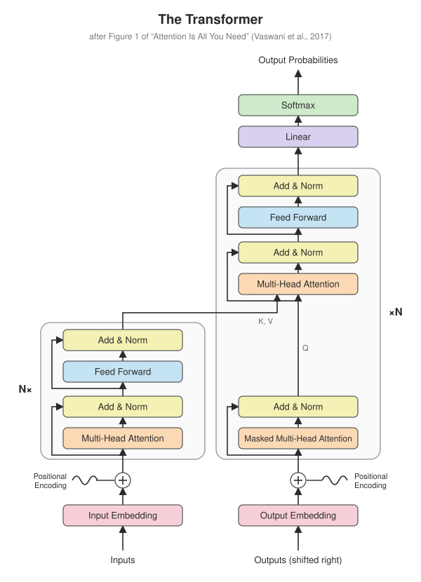
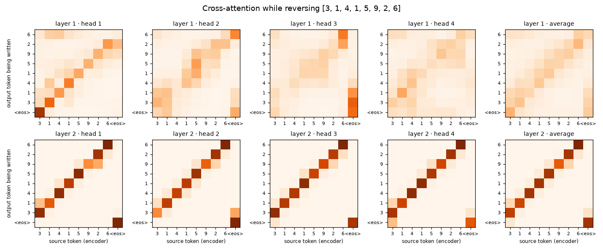
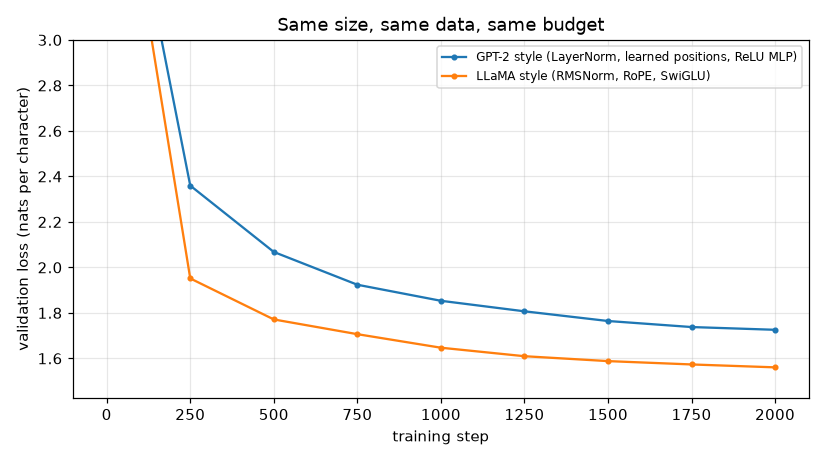
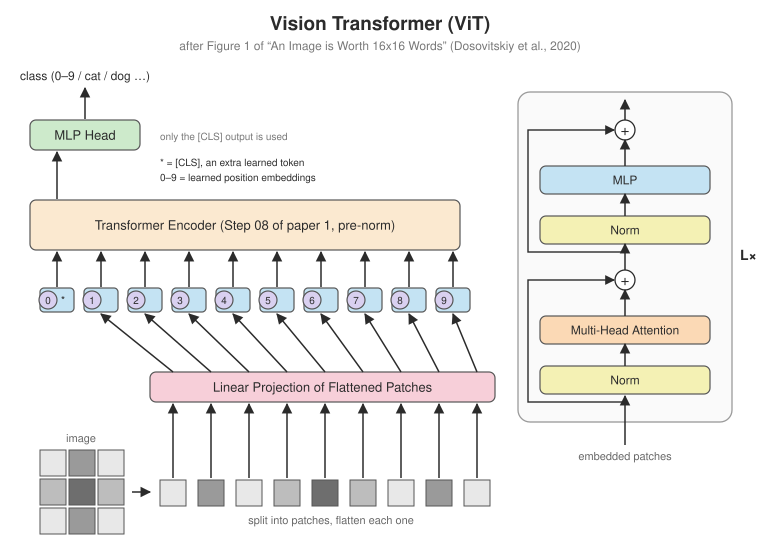
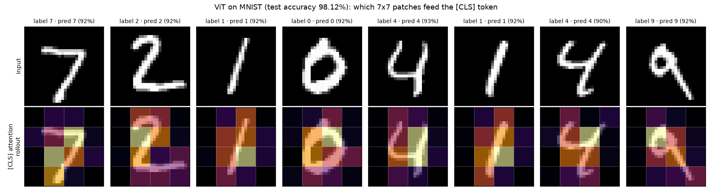
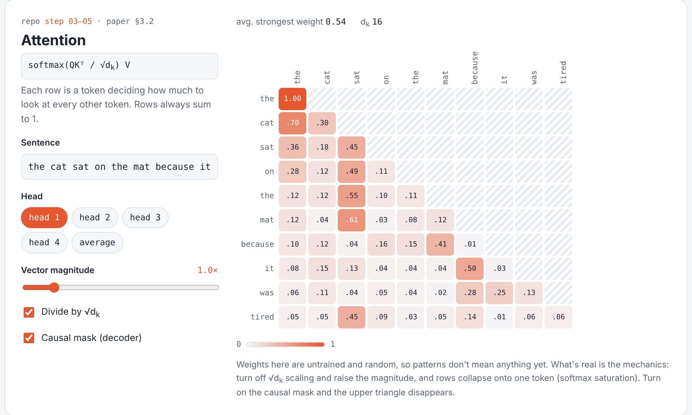
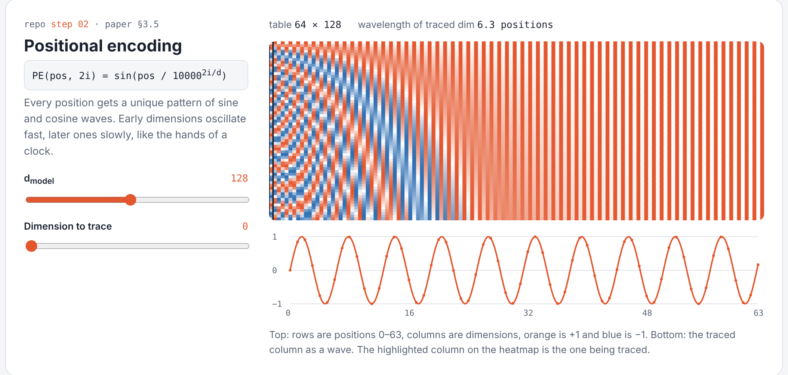
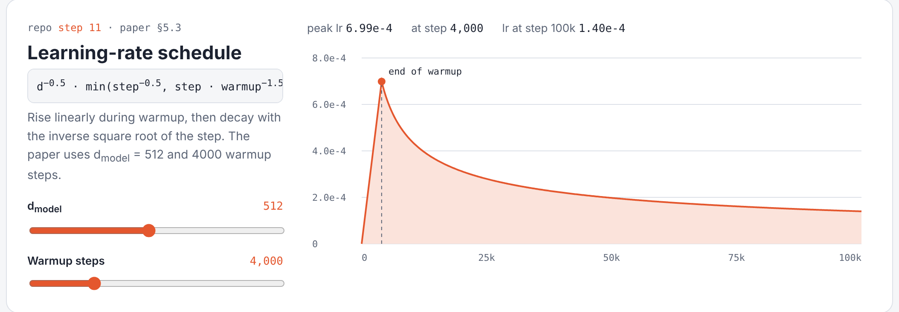
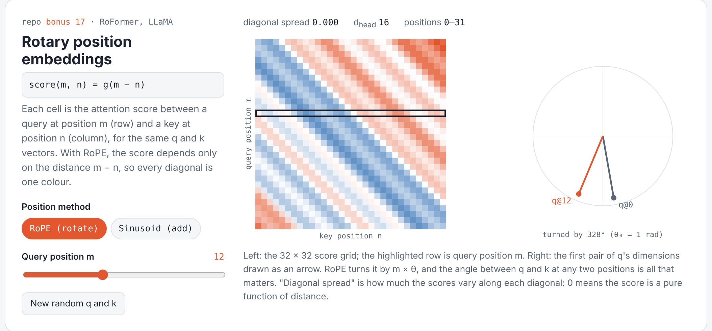

# paper-to-pytorch

[](https://github.com/rajdama/paper-to-pytorch/actions/workflows/tests.yml)
[](https://colab.research.google.com/github/rajdama/paper-to-pytorch/blob/main/notebooks/01_build_the_transformer.ipynb)

**Landmark deep-learning papers implemented from scratch in PyTorch, one folder per component.**

Each folder builds one piece of a paper's architecture, shows exactly where that piece sits
in the paper's diagram, tests it against the paper's formulas or PyTorch's built-ins, and
explains it. Later folders import earlier ones, so the folders combine into complete,
working models, which are then trained on GitHub's own servers to prove they work.

| | Paper | What you get |
|---|---|---|
| **1** | [Attention Is All You Need](#paper-1--attention-is-all-you-need) (2017) | the full encoder-decoder Transformer in 12 steps, trained and decoded with beam search |
| **→** | [From the Transformer to modern LLMs](#bonus--from-the-transformer-to-modern-llms) | GPT, BPE tokenizer, KV cache, LoRA, LLaMA-style upgrades |
| **2** | [An Image is Worth 16x16 Words](#paper-2--vision-transformer) (2020) | a Vision Transformer that reuses paper 1's encoder unchanged |

<p align="center"></p>

## Paper 1 · Attention Is All You Need

| | Step | Component | Paper section |
|:-:|---|---|---|
| ✅ | [01](step01_embeddings) | Token embeddings | 3.4 |
| ✅ | [02](step02_positional_encoding) | Positional encoding | 3.5 |
| ✅ | [03](step03_attention) | Scaled dot-product attention | 3.2.1 |
| ✅ | [04](step04_masking) | Padding & causal masks | 3.2.3 |
| ✅ | [05](step05_multi_head_attention) | Multi-head attention | 3.2.2 |
| ✅ | [06](step06_feed_forward) | Position-wise feed-forward | 3.3 |
| ✅ | [07](step07_add_and_norm) | Residual + layer norm | 3.1 |
| ✅ | [08](step08_encoder) | Encoder layer & stack | 3.1 |
| ✅ | [09](step09_decoder) | Decoder layer & stack (with cross-attention) | 3.1 |
| ✅ | [10](step10_full_transformer) | The full Transformer | 3 |
| ✅ | [11](step11_training) | Training (label smoothing, warmup schedule) | 5 |
| ✅ | [12](step12_inference) | Greedy decoding & beam search | 6.1 |

### Does it work?

Yes. The full encoder-decoder Transformer (234k parameters, Steps 01–12) trains on GitHub's
CPUs in about a minute on a toy translation task: reverse a sequence of digits.

```
[3, 5, 2, 2, 8, 9, 4, 2, 8]  ->  [8, 2, 4, 9, 8, 2, 2, 5, 3]
[2, 0, 3, 9, 5, 8, 5]        ->  [5, 8, 5, 9, 3, 0, 2]

exact-match accuracy on 200 unseen sequences
  greedy decoding:      99.0%
  beam search (k = 4):  98.0%
```

Its cross-attention shows *how* it solves the task: to write output token t, the decoder
looks at source token n − t, the anti-diagonal.

<p align="center"></p>

The numbers vary by a point or so between runs. Logs: [`results/transformer`](results/transformer).

## Bonus · From the Transformer to modern LLMs

| | Step | Component | Builds on |
|:-:|---|---|---|
| ✅ | [13](bonus/step13_gpt_decoder_only) | **TinyGPT**: a decoder-only language model trained on Shakespeare | Steps 04–07, 10 |
| ✅ | [14](bonus/step14_bpe_tokenizer) | **Byte Pair Encoding** tokenizer, from scratch | – |
| ✅ | [15](bonus/step15_kv_cache) | **KV cache** for fast generation | 03, 13 |
| ✅ | [16](bonus/step16_lora) | **LoRA** fine-tuning with ~2% of the parameters | 13 |
| ✅ | [17](bonus/step17_llama_style) | **LLaMA-style** block: RMSNorm, RoPE, SwiGLU | 03, 04, 13 |

All trained on GitHub's CPUs ([`results/`](results)):

| | Result |
|---|---|
| **TinyGPT** (0.8M parameters, 15 min) | validation loss 4.22 → **1.67** per character; writes play-shaped Shakespeare |
| **BPE** (1,024 tokens) | 2.43 bytes per token; learns `' the'` at merge 12 and whole names like `'GLOUCESTER'` |
| **KV cache** | identical output, **10.3× faster** at 448 tokens |
| **LoRA** (rank 8, 1.96% of parameters) | capital letters in generated text: 9% → **99%** |
| **LLaMA-style vs GPT-2-style** (same size and budget) | validation loss **1.561 vs 1.726**, with 14% less training time |

<p align="center"></p>

```
ROMEO:                                        ← TinyGPT, 512 BPE tokens, 15 CPU minutes
Thy father's night, to tell me.

DUKE VINCENTIO:
I am not so: the royal friends are here;
And I'll do more help my masters;
```

## Paper 2 · Vision Transformer

<p align="center"></p>

Cut an image into patches, treat each patch as a word, and feed the sequence to paper 1's
encoder ([Step 08](step08_encoder), imported unchanged). Three steps in [`vit/`](vit):
patch embedding, the ViT model, and training on MNIST.

A 139k-parameter ViT reaches **98.1% test accuracy on MNIST** after 6 epochs (2 minutes on
a CPU). Attention rollout shows which patches feed the [CLS] token:

<p align="center"></p>

## Notebooks

Run everything in your browser on a free GPU:

| Notebook | Covers | |
|---|---|:-:|
| **[1 · Build the Transformer](notebooks/01_build_the_transformer.ipynb)** | Steps 01–10, one component at a time | [](https://colab.research.google.com/github/rajdama/paper-to-pytorch/blob/main/notebooks/01_build_the_transformer.ipynb) |
| **[2 · Train the Transformer](notebooks/02_train_the_transformer.ipynb)** | Steps 11–12, cross-attention maps, and what happens without positional encoding | [](https://colab.research.google.com/github/rajdama/paper-to-pytorch/blob/main/notebooks/02_train_the_transformer.ipynb) |
| **[3 · TinyGPT](notebooks/03_tinygpt.ipynb)** | Bonus 13–17 with a bigger model on a GPU | [](https://colab.research.google.com/github/rajdama/paper-to-pytorch/blob/main/notebooks/03_tinygpt.ipynb) |

## Study guide

[`STUDY_GUIDE.md`](STUDY_GUIDE.md) has interview-style questions for every step, with
answers that point to the code and tests that demonstrate them.

## Playground

[`playground/index.html`](playground/index.html) is an interactive page that runs four
experiments live in your browser, using the same math as the code in this repo. Download it
and open it in any browser; no install needed.

<table>
<tr>
<td width="50%"><b>Attention</b> (Steps 03–05). Type any sentence, switch heads, toggle √d<sub>k</sub> scaling and the causal mask.<br></td>
<td width="50%"><b>Positional encoding</b> (Step 02). The sinusoid table, and any dimension traced as a wave.<br></td>
</tr>
<tr>
<td><b>Learning-rate schedule</b> (Step 11). The paper's warmup-then-decay, for any d<sub>model</sub> and warmup.<br></td>
<td><b>RoPE</b> (Bonus 17). With rotary embeddings every diagonal of the score grid is one colour: attention depends only on distance.<br></td>
</tr>
</table>

## What's in each step folder

```
stepNN_component/
├── README.md            what it does, the equation, where it sits in the diagram
├── diagram.svg          the architecture with this component highlighted
├── <component>.py       the implementation
├── test_<component>.py  shape checks + comparison with the paper / PyTorch's built-ins
└── demo.py              (some steps) a visualisation you can run
```

## Getting started

```bash
git clone https://github.com/rajdama/paper-to-pytorch.git
cd paper-to-pytorch
pip install -r requirements.txt   # Python 3.10+

pytest                                         # every test in the repo

python -m step03_attention.demo                # any step, always from the repo root
python -m step11_training.train_reverse        # train the Transformer (~1 min on CPU)
python -m bonus.step13_gpt_decoder_only.train_gpt
python -m vit.step03_train_mnist.train_mnist
```

### How the results are produced
- **[tests](.github/workflows/tests.yml)** runs on every push: all 120 unit tests, plus a full training run of the paper-1 Transformer and the ViT, and a short TinyGPT run.
- **[update results](.github/workflows/results.yml)** is run by hand (*Actions → update results → Run workflow*). It trains every model and commits the plots and logs to [`results/`](results), which the READMEs show.
- Diagrams are generated by [`tools/make_diagrams.py`](tools/make_diagrams.py) and [`tools/make_vit_diagrams.py`](tools/make_vit_diagrams.py); notebooks by [`tools/make_notebooks.py`](tools/make_notebooks.py).

## References

- Vaswani, A., Shazeer, N., Parmar, N., Uszkoreit, J., Jones, L., Gomez, A. N., Kaiser, Ł., & Polosukhin, I. (2017). *Attention Is All You Need.* NeurIPS. [arXiv:1706.03762](https://arxiv.org/abs/1706.03762)
- Dosovitskiy, A., et al. (2020). *An Image is Worth 16x16 Words: Transformers for Image Recognition at Scale.* ICLR 2021. [arXiv:2010.11929](https://arxiv.org/abs/2010.11929)
- Radford, A., et al. (2019). *Language Models are Unsupervised Multitask Learners* (GPT-2).
- Sennrich, R., Haddow, B., & Birch, A. (2016). *Neural Machine Translation of Rare Words with Subword Units.* [arXiv:1508.07909](https://arxiv.org/abs/1508.07909)
- Hu, E. J., et al. (2021). *LoRA: Low-Rank Adaptation of Large Language Models.* [arXiv:2106.09685](https://arxiv.org/abs/2106.09685)
- Touvron, H., et al. (2023). *LLaMA: Open and Efficient Foundation Language Models.* [arXiv:2302.13971](https://arxiv.org/abs/2302.13971)
- Su, J., et al. (2021). *RoFormer: Enhanced Transformer with Rotary Position Embedding.* [arXiv:2104.09864](https://arxiv.org/abs/2104.09864)

The architecture diagrams are redrawn after Figure 1 of each paper.
