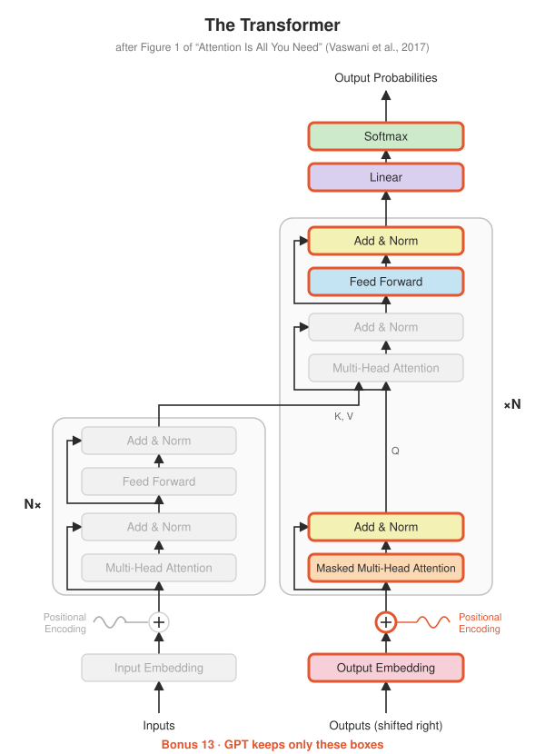
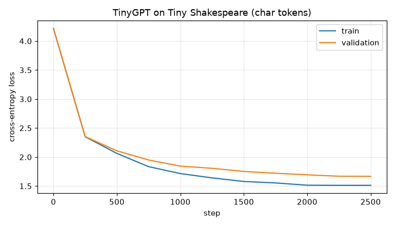

# Bonus 13 · TinyGPT: a decoder-only language model

<p align="center"></p>

**Papers:** Radford et al., *Improving Language Understanding by Generative Pre-Training* (GPT, 2018) and *Language Models are Unsupervised Multitask Learners* (GPT-2, 2019)

## The idea

GPT is the original Transformer with half of it removed. There is no source sentence to
translate, so there's no encoder, and without an encoder there's nothing for
cross-attention to read. What remains is a stack of **masked self-attention + feed-forward**
blocks trained on one job: **predict the next token.**

```
"To be or not to b"  ──►  TinyGPT  ──►  P(next char) = { "e": 0.93, "u": 0.02, ... }
```

Training uses the same teacher-forcing trick as Step 11: the target is the input shifted
left by one, and the causal mask makes every position a separate training example. A
block of 128 characters gives 128 predictions in one forward pass.

Every part is reused from the main steps:

| GPT block part | Built in |
|---|---|
| causal mask | [Step 04](../../step04_masking) |
| masked multi-head self-attention | [Step 05](../../step05_multi_head_attention) |
| feed-forward | [Step 06](../../step06_feed_forward) |
| residual + LayerNorm (pre-norm) | [Step 07](../../step07_add_and_norm) |
| weight tying between embedding and output | [Step 10](../../step10_full_transformer) |

What GPT-2 changed compared to the 2017 decoder:

- **Pre-norm** (`LayerNorm` before each sub-layer) plus a final `LayerNorm`. Much more stable when stacking many layers.
- **Learned position embeddings** instead of sinusoids. The catch: the model can never see more than `block_size` tokens.
- **Small initialisation** ($\mathcal{N}(0, 0.02)$), so the untrained model predicts a nearly uniform distribution, with loss $\approx \ln(\text{vocab})$. A test checks this.

## Sampling

Generation picks the next token, appends it, and repeats. *How* to pick is a design choice
(`sampling.py`):

| Knob | Effect |
|---|---|
| `temperature` | divides the logits: < 1 sharper and safer, > 1 flatter and wilder, 0 = always the top token (greedy) |
| `top_k` | sample only from the k most likely tokens |
| `top_p` | *nucleus sampling*: the smallest set of tokens whose probability adds up to p |

## Results

Trained on GitHub's CPUs: 818,048 parameters, 2,500 steps, about 15 minutes.

<p align="center"></p>

Validation loss falls from 4.22 (close to ln 65 ≈ 4.17, a uniform guess over 65 characters) to **1.668**.
A sample at temperature 0.8:

```
ROMEO:
The most kind self it one means by this toster.

First Senator:
The chath good be ever of the contents, your way,
Farewelly are off not my father well stone.

JULIET:
Their be stand of good them marry, what do heard do live
In it such of see, in I brace he would we such for well
```

It has learned the *shape* of a play (speaker names in capitals, a colon, line breaks,
verse-length lines) and most common words, but not much meaning. That's expected from
0.8M parameters and 15 CPU minutes. The [Colab notebook](https://colab.research.google.com/github/rajdama/paper-to-pytorch/blob/main/notebooks/03_tinygpt.ipynb)
trains a 10M-parameter version on a GPU.

The same model trained on **BPE tokens** (Bonus 14) writes noticeably more real words:

```
DUKE VINCENTIO:
I am not so: the royal friends are here;
And I'll do more help my masters;
But, call thy news, though I have prove
```

Logs: [`results/tinygpt`](../../results/tinygpt).

## What's implemented

| File | Contents |
|---|---|
| `gpt.py` | `GPTConfig`, `GPTBlock` (Step 09 decoder layer minus cross-attention), `GPT` |
| `sampling.py` | `filter_logits` (top-k, top-p), `sample_next` (temperature), `generate` |
| `char_tokenizer.py` | one token per character |
| `train_gpt.py` | training on Tiny Shakespeare: AdamW, warmup + cosine decay, train/val loss, sample |
| `generate.py` | generate from a checkpoint; `--kv-cache` uses Bonus 15 |
| `test_gpt.py` | shapes, initial loss ≈ ln(vocab), **causality**, top-k / top-p correctness, overfits a repeating pattern |

## Run it

```bash
python -m bonus.step13_gpt_decoder_only.test_gpt
python -m bonus.step13_gpt_decoder_only.train_gpt                  # downloads Tiny Shakespeare, ~5 min on CPU
python -m bonus.step13_gpt_decoder_only.generate --prompt "JULIET:" --temperature 0.8
```

For a much better model, use the [Colab notebook](https://colab.research.google.com/github/rajdama/paper-to-pytorch/blob/main/notebooks/03_tinygpt.ipynb) on a free GPU (about 10M parameters, ~10 minutes).

## Try this

- Generate with `--temperature 0` (greedy). Why does it get stuck in loops?
- Swap ReLU for GELU in the feed-forward (GPT-2 uses GELU). Does validation loss change?
- Train with `--tokenizer bpe` (Bonus 14). The loss numbers aren't comparable to the character model's. Why not?
