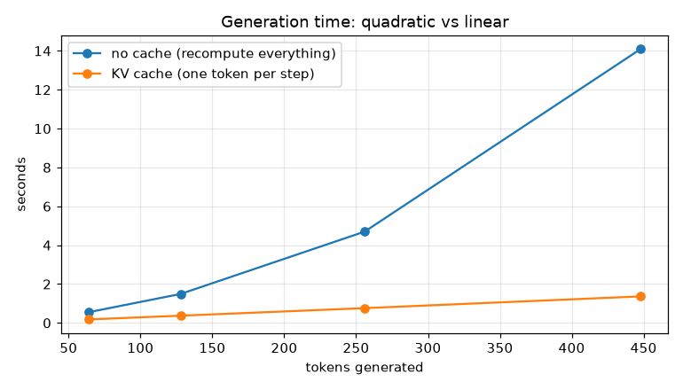

# Bonus 15 · KV cache

**Context:** every production LLM inference engine (vLLM, llama.cpp, Hugging Face `generate`) uses this.

## The idea

Bonus 13's `generate()` re-runs the whole model on the entire context for **every new
token**. Generating $n$ tokens costs about $n^2/2$ token computations, and most of that work
is repeated.

The key observation: **with a causal mask, old tokens never change.** Token 5 can't see
token 6, so adding token 6 doesn't change token 5's keys and values in any layer. So keep
them:

```
prefill:   run the whole prompt once, store K and V for every layer
decode:    for each new token
             compute q, k, v for that ONE token
             append k, v to the cache
             attend from q to all cached keys/values   (no mask needed: the cache is all past)
```

Now each step processes one token, and generation is linear in length instead of
quadratic. The model's weights don't change at all; `kv_cache.py` only rewrites the forward
pass, reusing Step 03's attention function and Bonus 13's modules.

### The cost: memory
The cache holds `layers × 2 × heads × tokens × d_k` numbers per sequence. For a 7B-parameter
model with a long context, that's gigabytes per user, which is why techniques like
multi-query / grouped-query attention (fewer K/V heads) and paged caches exist.

### A bug the tests caught
The first version computed the prompt mask offset from `cache.length`, which read **layer 0's**
cache. By the time layer 1 runs, layer 0 has already been extended, so the offset was wrong
for every later layer. The rule: each layer must use its own cache length (`layer_length(layer)`).
Comparing cached and uncached logits position by position is what exposed it.

## Results

A 5M-parameter TinyGPT on GitHub's CPUs, greedy decoding, both methods producing
**identical tokens** in every run:

| new tokens | no cache | KV cache | speedup |
|---:|---:|---:|---:|
| 64 | 0.55 s | 0.18 s | 3.1× |
| 128 | 1.49 s | 0.37 s | 4.0× |
| 256 | 4.70 s | 0.76 s | 6.2× |
| 448 | 14.10 s | 1.36 s | **10.3×** |

<p align="center"></p>

Without the cache, time grows quadratically; with it, linearly, at a steady ~330 tokens per
second. The longer the generation, the bigger the win. Log: [`results/tinygpt/benchmark_log.txt`](../../results/tinygpt/benchmark_log.txt).

## What's implemented

| File | Contents |
|---|---|
| `kv_cache.py` | `KVCache`, `cached_attention`, `forward_with_cache`, `generate_with_kv_cache` |
| `test_kv_cache.py` | cached logits **equal** the full forward pass (prefill, token by token, and mixed), greedy and sampled generation give **identical tokens**, cache size, block-size limit |
| `benchmark.py` | times both methods at several lengths, checks outputs match, saves `benchmark.png` |

## Run it

```bash
python -m bonus.step15_kv_cache.test_kv_cache
python -m bonus.step15_kv_cache.benchmark
python -m bonus.step13_gpt_decoder_only.generate --kv-cache --prompt "ROMEO:"
```

## Try this

- Print `cache.num_bytes()` after generating 400 tokens. Scale it up to GPT-3's size (96 layers, $d_{model}$ = 12,288, 2,048 tokens). How many GB per sequence?
- Why can't this cache simply slide forward past `block_size`? (Hint: learned absolute positions. Models using RoPE handle this better.)
