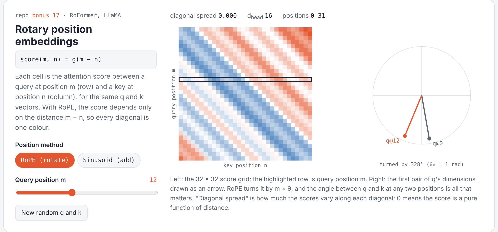
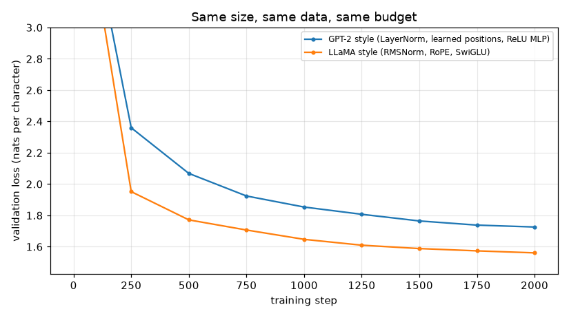

# Bonus 17 · From GPT-2 to LLaMA: RMSNorm, RoPE, SwiGLU

**Papers:** Touvron et al., *LLaMA* (2023); Zhang & Sennrich, *Root Mean Square Layer Normalization* (2019); Su et al., *RoFormer: Enhanced Transformer with Rotary Position Embedding* (2021); Shazeer, *GLU Variants Improve Transformer* (2020)

## The idea

Open models from LLaMA onwards (Mistral, Qwen, Gemma and others) are still the decoder-only
Transformer from Bonus 13. They swap three parts:

| Part | GPT-2 (Bonus 13) | LLaMA (this step) |
|---|---|---|
| normalisation | LayerNorm: subtract mean, divide by std, scale + shift | **RMSNorm**: divide by root-mean-square, scale. Cheaper, works as well |
| positions | a learned vector **added** to each token, up to `block_size` | **RoPE**: **rotate** q and k by an angle proportional to position |
| feed-forward | `W2 · ReLU(W1 x)` | **SwiGLU**: `W2 · (SiLU(W1 x) ⊙ W3 x)`, a learned gate |

### RoPE, the interesting one
Split each query and key vector into pairs of numbers and rotate pair $i$ by angle
$m \cdot \theta_i$, where $m$ is the token's position and $\theta_i$ uses the same frequencies as
the paper-1 sinusoids. Rotations preserve dot products up to the angle *between* the
vectors, so

$$\langle \text{RoPE}(q, m),\ \text{RoPE}(k, n) \rangle \text{ depends only on } m - n.$$

Attention scores become a function of **relative** distance, and there's no position table
with a hard length limit. `test_rope_depends_only_on_relative_position` checks exactly this.

### SwiGLU sizing
SwiGLU has three matrices instead of two, so LLaMA shrinks the hidden size to
$\frac{2}{3} \cdot 4d$ to keep the parameter count the same. A test checks the budgets match.

## See it live

The [Playground](../../playground/index.html) has a RoPE experiment: the score between the same q and k at every pair of positions. With RoPE, every diagonal is one colour.

<p align="center"></p>

## The experiment

`compare.py` trains both models on Tiny Shakespeare characters with the **same** size
(about 0.8M parameters each), data order, optimizer and number of steps.

Results from GitHub's CPUs, 2,000 steps each:

| | parameters | validation loss | training time |
|---|---|---|---|
| GPT-2 style (LayerNorm, learned positions, ReLU MLP) | 818,048 | 1.726 | 619 s |
| **LLaMA style (RMSNorm, RoPE, SwiGLU)** | 800,000 | **1.561** | 535 s |

<p align="center"></p>

The LLaMA-style model is ahead at every checkpoint: after 500 steps (1.771) it's about where
the GPT-2-style model is after 1,500 (1.764). It also trains faster per step. Samples at the
end (temperature 0.8):

```
GPT-2 style:  ROMEO:
              Threfore these not made a means.

              LAdserecen:
              Are of thy hath were my strange showell!

LLaMA style:  ROMEO:
              Thy mother's presence, canner, you do I to thee,
              Is yet given you receive the seemely!
```

One run at one small scale, so treat the gap as indicative rather than exact. Log:
[`results/llama/compare_log.txt`](../../results/llama/compare_log.txt).

## What's implemented

| File | Contents |
|---|---|
| `llama.py` | `RMSNorm`, `rope_cache` / `apply_rope`, `RoPEAttention` (reuses Step 03), `SwiGLU`, `LlamaBlock`, `TinyLlama` (same interface as TinyGPT) |
| `test_llama.py` | RMSNorm formula, RoPE: identity at 0, preserves length, **relative-position property**; SwiGLU parameter budget, causality, runs past `block_size`, works with Bonus 13's sampler |
| `compare.py` | trains both models side by side, plots validation loss |

## Run it

```bash
python -m bonus.step17_llama_style.test_llama
python -m bonus.step17_llama_style.compare           # ~10 min on CPU
```

## Try this

- Swap in one upgrade at a time (only RMSNorm, only RoPE, only SwiGLU). Which one helps most at this scale?
- Generate 400 tokens with TinyLlama trained on 128-character blocks. TinyGPT can't go past 128 positions at all; what happens to TinyLlama's text beyond 128?
- Grouped-query attention (used in LLaMA 2 70B) shares one K/V head across several query heads. Combined with Bonus 15, what does it save?
