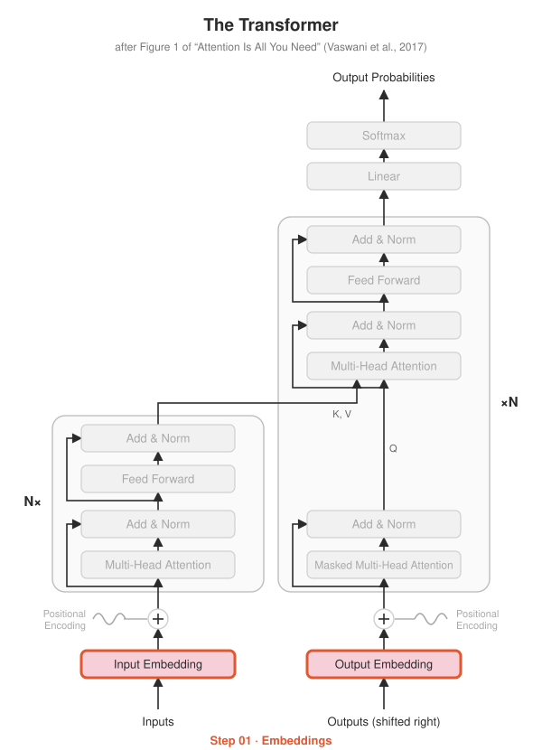

# Step 01 · Embeddings

<p align="center"></p>

**Paper:** Section 3.4, *Embeddings and Softmax*

## The idea

A model can't do math on words, only on numbers. The tokenizer turns text into
integer ids (`"hello world" → [31, 87]`), and the embedding layer turns each id into
a vector of size `d_model` (512 in the paper). It's simply a lookup table with one
learned row per token in the vocabulary.

$$\text{Embedding}(x) = W_E[x] \cdot \sqrt{d_{model}}$$

Why multiply by $\sqrt{d_{model}}$? The positional encodings added in Step 02 have
values in $[-1, 1]$. Scaling the embeddings up keeps the token meaning from being
drowned out by the position signal.

## What's implemented

| File | Contents |
|---|---|
| `embeddings.py` | `TokenEmbedding`: `nn.Embedding` + the $\sqrt{d_{model}}$ scaling |
| `test_embeddings.py` | shape, scaling, same-token-same-vector, padding token |

## Run it

```bash
python -m step01_embeddings.test_embeddings
```

## Try this

- The paper **shares** the weight matrix between the input embedding, output embedding
  and the final Linear layer. Why might that work, and what does it save? (We'll do it in Step 10.)
- Print `emb.embedding.weight.shape`. With vocab 37,000 and `d_model` 512, how many
  parameters is that?
