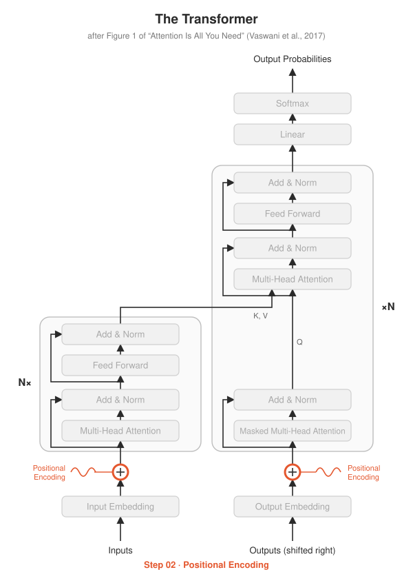
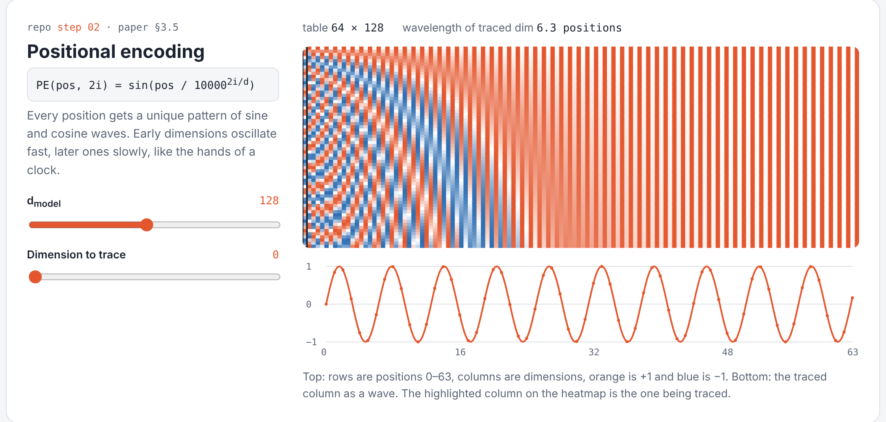

# Step 02 · Positional Encoding

<p align="center"></p>

**Paper:** Section 3.5, *Positional Encoding*

## The idea

Attention looks at all tokens at once, so on its own it can't tell
"dog bites man" from "man bites dog". We fix that by **adding** a position signature
to each token's embedding. The paper uses sine and cosine waves of different frequencies:

$$PE_{(pos,\,2i)} = \sin\left(\frac{pos}{10000^{2i/d_{model}}}\right) \qquad PE_{(pos,\,2i+1)} = \cos\left(\frac{pos}{10000^{2i/d_{model}}}\right)$$

Each dimension is a wave: early dimensions oscillate fast, later ones slowly, like the
hands of a clock. Together they give every position a unique pattern, and nothing
here is learned.

## What's implemented

| File | Contents |
|---|---|
| `positional_encoding.py` | `sinusoidal_table()` builds the table; `PositionalEncoding` adds it to embeddings (+ dropout, as in the paper) |
| `test_positional_encoding.py` | shape, range, position 0, checks every value against the paper's formula, uniqueness |
| `demo.py` | saves `pe_heatmap.png`, a picture of the table |

## Run it

```bash
python -m step02_positional_encoding.test_positional_encoding
python -m step02_positional_encoding.demo
```

## See it live

Open [`playground/index.html`](../playground/index.html) to change $d_{model}$ and trace any dimension as a wave.

<p align="center"></p>

## Try this

- Open `pe_heatmap.png`. Can you see the "clock hands" running at different speeds?
- Replace the sinusoids with a **learned** `nn.Embedding(max_len, d_model)`. The paper says
  both work about equally well (Table 3, row E). What's the advantage of sinusoids for
  sequences longer than any seen in training?
- Modern LLMs (LLaMA, Qwen) use **RoPE** instead. We'll revisit this in the bonus steps.
