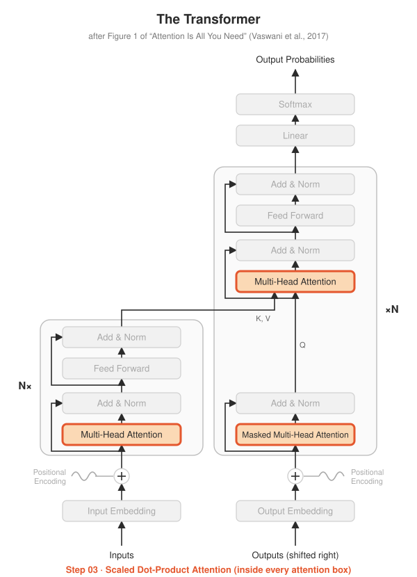

# Step 03 · Scaled Dot-Product Attention

<p align="center"></p>

**Paper:** Section 3.2.1, *Scaled Dot-Product Attention* (Figure 2, left)

## The idea

Every token asks a question and every token offers an answer:

- **Q**uery: what am I looking for?
- **K**ey: what do I contain?
- **V**alue: what do I pass on if you pick me?

Compare each query with every key (dot product), turn the scores into probabilities
(softmax), and take a weighted average of the values:

$$\text{Attention}(Q, K, V) = \text{softmax}\left(\frac{QK^\top}{\sqrt{d_k}}\right)V$$

**Why divide by $\sqrt{d_k}$?** Dot products of long vectors get large. Large scores
push softmax towards one-hot outputs whose gradients are almost zero, so learning
stalls. Scaling keeps the scores in a healthy range (paper, footnote 4).

This one function is used inside **all three** attention boxes in the diagram. Steps
04 and 05 wrap it with masks and multiple heads.

## What's implemented

| File | Contents |
|---|---|
| `attention.py` | `scaled_dot_product_attention(q, k, v, mask)`, returning output and weights |
| `test_attention.py` | shapes (incl. different query/key lengths), rows sum to 1, **matches PyTorch's built-in**, masking, 4-D (heads) input |
| `demo.py` | hand-made "animals vs colours" example, saves `attention_heatmap.png` |

## Run it

```bash
python -m step03_attention.test_attention
python -m step03_attention.demo
```

## Try this

- In `demo.py`, multiply all vectors by 10 and remove the `/ sqrt(d_k)` line. What happens
  to the heatmap? That's the problem scaling solves.
- Why can `k` and `v` have a different sequence length from `q`? Find the box in the diagram
  where that happens. (Hint: it's labelled K, V.)
