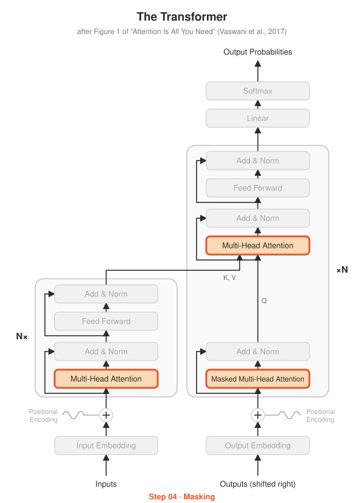

# Step 04 · Masking

<p align="center"></p>

**Paper:** Section 3.2.3, *Applications of Attention in our Model*

## The idea

Attention lets every token look at every other token. Two situations need a rule
that says "don't look there":

**1. Padding mask.** Sentences in a batch have different lengths, so short ones are
filled with `<pad>`. Those fillers carry no meaning, so nobody should attend to them.

```
tokens:  [ I  love  cats  <pad> <pad> ]
mask:    [ ✓   ✓     ✓     ✗     ✗   ]
```

**2. Causal (look-ahead) mask.** During training the decoder sees the whole target
sentence at once, but when *predicting* word 3 it must not see word 4, or it would
just copy the answer. So position $i$ may only look at positions $0 \ldots i$:

```
          k0 k1 k2 k3
    q0  [ ✓  ✗  ✗  ✗ ]
    q1  [ ✓  ✓  ✗  ✗ ]
    q2  [ ✓  ✓  ✓  ✗ ]
    q3  [ ✓  ✓  ✓  ✓ ]
```

The paper implements this by setting the scores of illegal connections to $-\infty$
before the softmax. Since $e^{-\infty} = 0$, blocked
positions get exactly zero attention. Step 03's function already does this when given a mask.

| Where in the diagram | Mask used |
|---|---|
| Encoder self-attention | padding mask (source) |
| Decoder **masked** self-attention | padding **and** causal |
| Decoder cross-attention (K, V from encoder) | padding mask (source) |

## What's implemented

| File | Contents |
|---|---|
| `masks.py` | `make_padding_mask`, `make_causal_mask`, `make_decoder_mask`, all returning 4-D bool tensors (`True` = may attend) |
| `test_masks.py` | exact mask values, pads get zero attention, **changing a future token doesn't change earlier outputs**, and why a fully masked row produces NaN |

## Run it

```bash
python -m step04_masking.test_masks
```

## Try this

- Read `test_fully_masked_row_gives_nan`. Why does every target sequence start with a `<bos>` token?
- GPT-style models (bonus Step 13) use **only** the causal mask. Why don't they need cross-attention masks?
