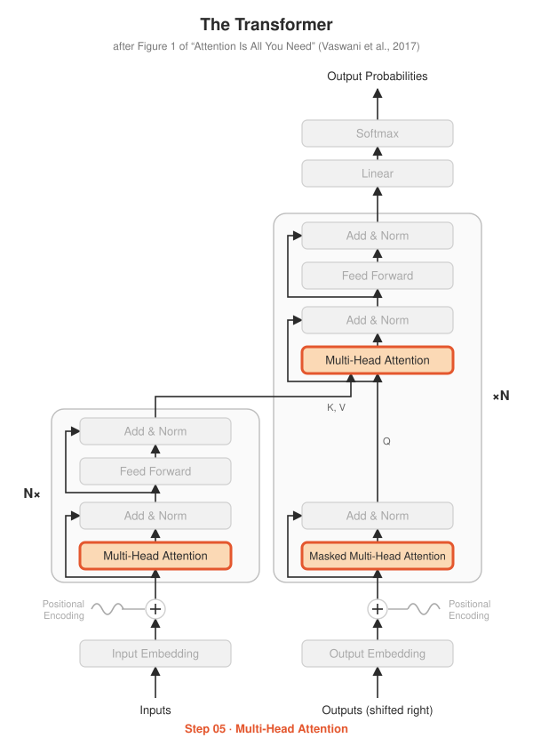

# Step 05 · Multi-Head Attention

<p align="center"></p>

**Paper:** Section 3.2.2, *Multi-Head Attention* (Figure 2, right)

## The idea

One attention computes one weighted average, so it can only capture one kind of
relationship at a time. Multi-head attention runs $h$ attentions in parallel, each on
its own learned projection of the input, then glues the results together:

$$\text{MultiHead}(Q,K,V) = \text{Concat}(\text{head}_1, \ldots, \text{head}_h)\,W^O$$
$$\text{head}_i = \text{Attention}(QW_i^Q,\; KW_i^K,\; VW_i^V)$$

The paper uses $h = 8$ heads with $d_k = d_{model}/h = 64$ each, so the total cost is
about the same as one big attention, but each head can learn something different.

**The reshape trick:** we don't create 8 separate small Linear layers. One
`Linear(512, 512)` produces all 8 heads' projections at once, then we reshape:

```
(batch, seq, 512) → (batch, seq, 8, 64) → (batch, 8, seq, 64)
```

Now Step 03's function runs all 8 heads in parallel, because it already supports an
extra leading dimension.

## What's implemented

| File | Contents |
|---|---|
| `multi_head_attention.py` | `MultiHeadAttention(d_model, num_heads)` with self- and cross-attention support |
| `test_multi_head_attention.py` | shapes, cross-attention with different lengths, **exact match against `torch.nn.MultiheadAttention`** (with and without a causal mask), parameter count |
| `demo.py` | saves `heads.png`, one attention map per head |

## Run it

```bash
python -m step05_multi_head_attention.test_multi_head_attention
python -m step05_multi_head_attention.demo
```

## Try this

- In the test, PyTorch's `attn_mask` needed `~mask`. Why? (Different libraries use opposite mask conventions, a classic source of bugs.)
- Count parameters for `d_model = 512`: does the number of heads change it? Why not?
