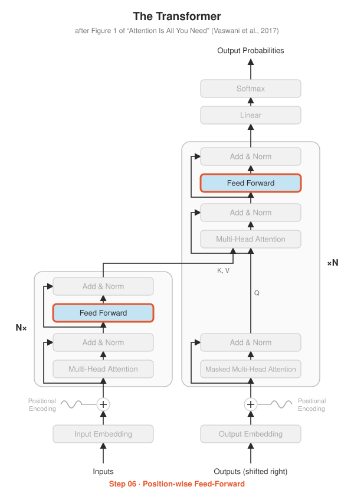

# Step 06 · Position-wise Feed-Forward Network

<p align="center"></p>

**Paper:** Section 3.3, *Position-wise Feed-Forward Networks*

## The idea

After attention has let tokens exchange information, each token goes through a small
two-layer neural network **on its own**:

$$\text{FFN}(x) = \max(0,\; xW_1 + b_1)\,W_2 + b_2$$

It expands each vector from $d_{model} = 512$ to $d_{ff} = 2048$, applies ReLU, and
projects back to 512. The same weights are used at every position, which is why it's
called *position-wise*.

A useful way to think about the two halves of a Transformer layer:

| Sub-layer | Job |
|---|---|
| Attention | **communication**: tokens gather information from each other |
| Feed-forward | **computation**: each token processes what it gathered |

The FFN holds about **two thirds** of each layer's parameters, and research suggests a
lot of a model's factual "knowledge" is stored here.

## What's implemented

| File | Contents |
|---|---|
| `feed_forward.py` | `PositionwiseFeedForward(d_model, d_ff, dropout)` |
| `test_feed_forward.py` | shape, **each position processed independently**, matches the paper's formula, parameter count |

## Run it

```bash
python -m step06_feed_forward.test_feed_forward
```

## Try this

- The paper notes this is the same as two convolutions with kernel size 1. Can you rewrite it with `nn.Conv1d` and check the outputs match?
- Modern LLMs replace ReLU with **SwiGLU**. Look it up and try implementing it as `PositionwiseFeedForwardSwiGLU`.
