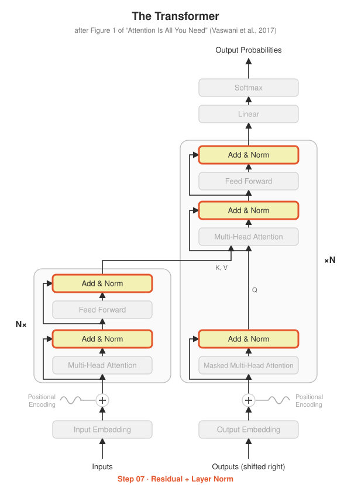

# Step 07 · Residual Connection + Layer Norm

<p align="center"></p>

**Paper:** Section 3.1 (*Encoder and Decoder Stacks*) and Section 5.4 (*Residual Dropout*)

## The idea

Every yellow "Add & Norm" box in the diagram does two things.

**Add (residual connection).** The input skips around the sub-layer and is added back:
$x + \text{Sublayer}(x)$. The sub-layer only has to learn a *change* to $x$, not rebuild
it from scratch, and gradients get a direct highway back through deep stacks. That's the
arrows looping around each box in the diagram.

**Norm (layer normalization).** Rescale each token's vector to mean 0 and variance 1,
then apply a learned scale $\gamma$ and shift $\beta$:

$$\text{LayerNorm}(x) = \gamma \cdot \frac{x - \mu}{\sqrt{\sigma^2 + \epsilon}} + \beta$$

This keeps activations from growing or shrinking as they pass through many layers.

Together, as in the paper (plus dropout on the sub-layer output, Section 5.4):

$$\text{output} = \text{LayerNorm}(x + \text{Dropout}(\text{Sublayer}(x)))$$

### Post-norm vs pre-norm

The paper normalises **after** adding (post-norm). Almost every modern LLM (GPT-2 onwards)
normalises **before** the sub-layer (pre-norm), which trains more stably in deep models.
`SublayerConnection` supports both with `pre_norm=True/False`.

## What's implemented

| File | Contents |
|---|---|
| `add_and_norm.py` | `LayerNorm` from scratch, `SublayerConnection` (post- or pre-norm) |
| `test_add_and_norm.py` | **matches `nn.LayerNorm`**, output has mean 0 / variance 1, both formulas, gradient flows through the skip path |

## Run it

```bash
python -m step07_add_and_norm.test_add_and_norm
```

## Try this

- Why does `LayerNorm` use `unbiased=False` for the variance? Try `True` and see which test breaks.
- LLaMA uses **RMSNorm**, which skips the mean subtraction. Implement it in a few lines.
