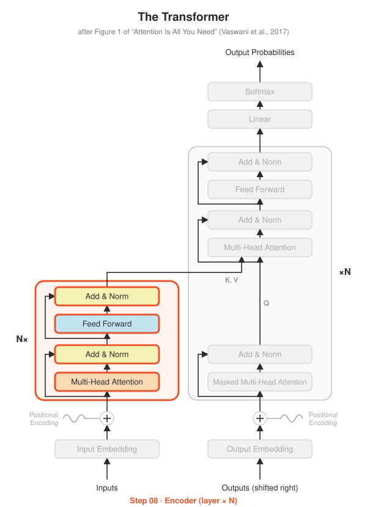

# Step 08 · The Encoder

<p align="center"></p>

**Paper:** Section 3.1, *Encoder and Decoder Stacks*

## The idea

No new math in this step: it's pure assembly of Steps 05–07. One encoder layer is
the left-hand box in the diagram:

```
x ──► Multi-Head Self-Attention ──► Add & Norm ──► Feed-Forward ──► Add & Norm ──► out
 └──────────── residual ───────────┘    └──────── residual ────────┘
```

Stack $N = 6$ of them (each with its **own** weights) and you have the encoder. In code,
the whole layer is two lines:

```python
x = self.sublayer1(x, lambda t: self.self_attn(t, t, t, src_mask))
x = self.sublayer2(x, self.feed_forward)
```

The encoder reads the entire source sentence at once (no causal mask: every token can
see every other token) and outputs one context-rich vector per source token. The
decoder reads this output, called the **memory**, through its cross-attention (Step 09).

## What's implemented

| File | Contents |
|---|---|
| `encoder.py` | `EncoderLayer`, `Encoder` (N layers; optional pre-norm with a final LayerNorm) |
| `test_encoder.py` | shapes, layers are independent, **garbage in pad slots doesn't change real outputs**, no causal restriction, pre-norm variant |

## Run it

```bash
python -m step08_encoder.test_encoder
```

## Try this

- BERT is basically *just this encoder*, trained to fill in masked-out words. What would you need to add to turn this folder into a mini-BERT?
- Why does the pre-norm version need `final_norm` but the post-norm version doesn't?
