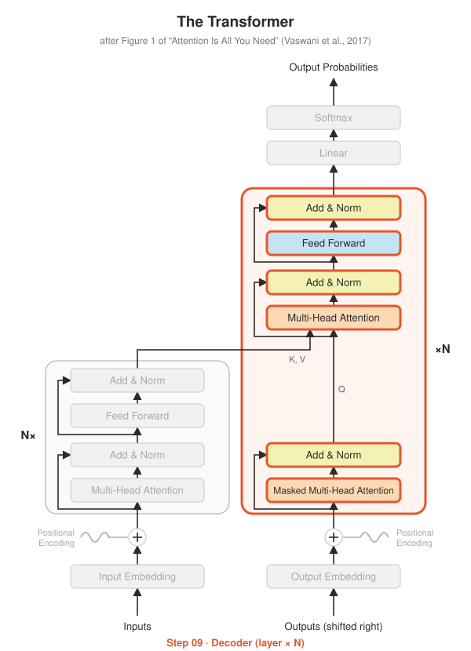

# Step 09 · Decoder

> 🚧 **Not built yet.** This page describes the plan for this step.

**Paper:** Section 3.1

## The idea

One decoder layer = **masked** self-attention, then **cross-attention** (queries from the decoder, keys and values from the encoder output), then feed-forward. Stack $N = 6$.

## Planned

- `DecoderLayer`, `Decoder`
- test: changing a future target token doesn't change earlier outputs
