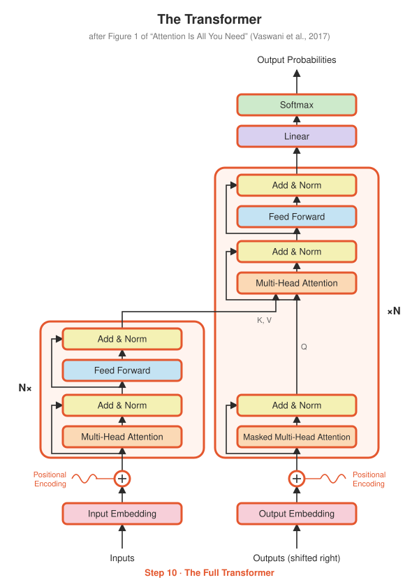

# Step 10 · The Full Transformer

<p align="center"></p>

**Paper:** Section 3 and Figure 1

## The idea

Every box in the diagram is now built. This step wires them together:

```
source ids ─► Embedding (01) ─► + PE (02) ─► Encoder ×6 (08) ──────────┐ memory
                                                                       ▼
target ids ─► Embedding (01) ─► + PE (02) ─► Decoder ×6 (09) ─► Linear ─► logits
(shifted right)
```

Notice how short `transformer.py` is: all the work happened in Steps 01–09.

### Details from the paper worth knowing

- **Weight tying (Section 3.4).** The target embedding and the final Linear layer share one
  matrix. The embedding maps word → vector, the Linear maps vector → word score, so it
  makes sense for them to be the same table. With a shared source/target vocabulary, all
  three share it, saving ~38M parameters in the base model.
- **Logits, not probabilities.** `forward` returns raw scores. The softmax is applied inside
  the loss function (Step 11) or the sampler (Step 12), which is more numerically stable.
- **`encode` and `decode` are separate methods** because at inference time the encoder runs
  once while the decoder runs once per generated word.

## Base model size

Run `python -m step10_full_transformer.summary`, which reports about **63.1M** parameters
against the paper's ~65M (Table 3). The small gap comes from details the paper doesn't
fully specify, such as exact vocabulary size and which biases are counted.

## What's implemented

| File | Contents |
|---|---|
| `transformer.py` | `Transformer` with `encode` / `decode` / `forward`, weight tying, Xavier init |
| `test_transformer.py` | logits shape, weight tying, **base model ≈ paper's size**, end-to-end causality, **overfits a tiny batch** (proves gradients flow through everything) |
| `summary.py` | parameter breakdown of the base model |

## Run it

```bash
python -m step10_full_transformer.test_transformer
python -m step10_full_transformer.summary
```

## Try this

- From the summary: which uses more parameters, attention or feed-forward?
- The "big" model in Table 3 uses `d_model=1024, d_ff=4096, num_heads=16`. Build it and count its parameters (paper: 213M).
