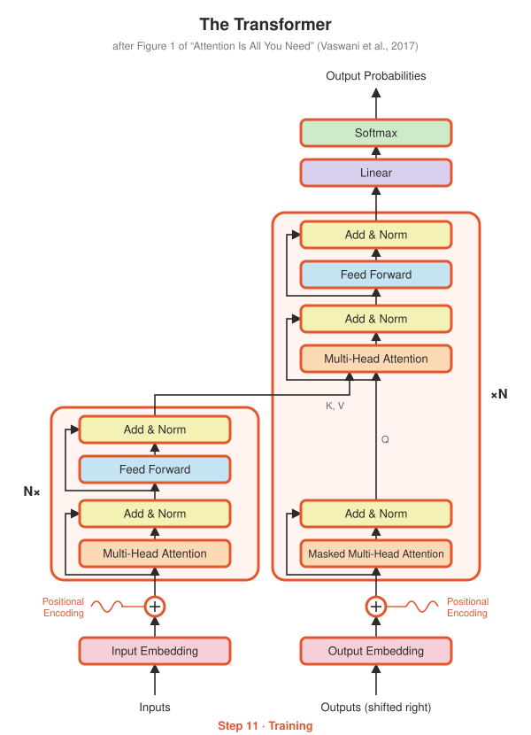
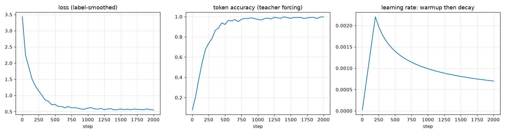
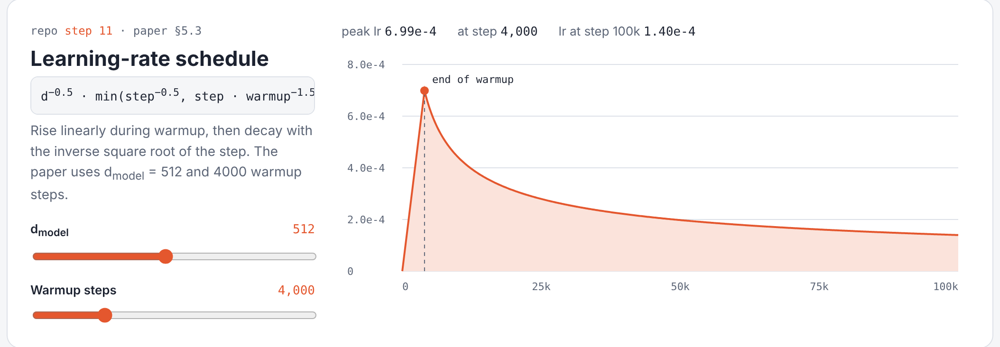

# Step 11 · Training

<p align="center"></p>

**Paper:** Section 5, *Training*

## The idea

### Teacher forcing
During training the decoder gets the **correct** target, shifted right by one, and
predicts every next token at once. The causal mask (Step 04) keeps it honest:

```
decoder input  (tgt_in):  <bos>  9   4   7
must predict   (tgt_out):   9    4   7  <eos>
```

All positions train in parallel in one forward pass. That's a big reason Transformers
train so much faster than RNNs.

### Label smoothing (Section 5.4, ε = 0.1)
Instead of training towards "100% this word", the target is 90% the right word and
10% spread over the vocabulary:

$$\mathcal{L} = (1-\varepsilon)\cdot(-\log p_{\text{correct}}) + \varepsilon \cdot \frac{1}{V}\sum_{w}(-\log p_w)$$

The paper reports this makes perplexity worse but accuracy and BLEU better: the
model learns to be less over-confident.

### The learning-rate schedule (Section 5.3)
Adam with $\beta_1 = 0.9$, $\beta_2 = 0.98$, $\epsilon = 10^{-9}$, and a learning rate that
rises linearly for `warmup` steps, then decays with the inverse square root of the step:

$$\text{lr} = d_{model}^{-0.5} \cdot \min(\text{step}^{-0.5},\ \text{step}\cdot\text{warmup}^{-1.5})$$

Warmup matters: early on, Adam's statistics are unreliable and post-norm Transformers
can blow up if hit with a large learning rate.

## The toy task: reversing sequences

Real translation needs a big dataset and hours of GPU time. To prove the whole
model works end to end, we train on a task that runs on a laptop CPU in about a minute:

```
source:  3 1 4 1 5 <eos>
target:  <bos> 5 1 4 1 3 <eos>
```

It's a good test because the model can't cheat: it must use **positional encoding** to
know where tokens are, and **cross-attention** to fetch the right source token for each
output position.

## What's implemented

| File | Contents |
|---|---|
| `training.py` | `LabelSmoothingLoss`, `noam_lr`, `make_optimizer`, `reverse_task_batch` |
| `train_reverse.py` | full training loop, saves `checkpoints/reverse.pt` and `training_curves.png` |
| `test_training.py` | **label smoothing matches PyTorch's**, schedule peaks exactly at warmup, data format, a short run actually learns |

## Run it

```bash
python -m step11_training.test_training
python -m step11_training.train_reverse          # ~1-2 minutes on CPU
```

Then look at `training_curves.png`: the loss falls, accuracy climbs to near 100%, and
the learning rate traces the warmup-then-decay shape from the paper.

## Results

From the [results workflow](../results/transformer/train_log.txt), on GitHub's CPUs:

<p align="center"></p>

Token accuracy reaches 99.8% after 2,000 steps (about a minute). The learning-rate panel
traces the paper's schedule: linear warmup for 200 steps, then $1/\sqrt{\text{step}}$ decay.

## See it live

Open [`playground/index.html`](../playground/index.html) to change $d_{model}$ and warmup and see how the schedule moves.

<p align="center"></p>

## Try this

- Set `--warmup 1` (no warmup). Does training still work?
- Set label smoothing to `0.0`. The loss goes much lower; does accuracy actually improve?
- Remove the positional encoding in Step 10 (`self.positional` → identity) and retrain. Why does reversing become impossible?
