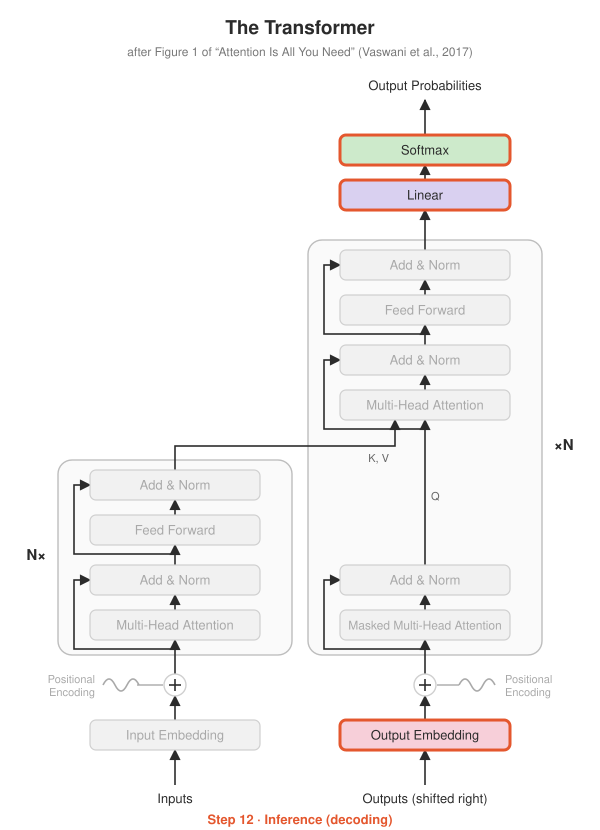

# Step 12 · Inference

<p align="center"></p>

**Paper:** Section 6.1 (beam search with beam size 4 and length penalty α = 0.6)

## The idea

At inference time there's no target sentence to feed the decoder. So we generate
**autoregressively**, one token at a time:

```
<bos>                     → model predicts 5
<bos> 5                   → model predicts 1
<bos> 5 1                 → model predicts 4
...                       → until it predicts <eos>
```

The encoder runs **once**; the decoder runs once per generated token. That's why
Step 10 split the model into `encode()` and `decode()`. (Recomputing the whole prefix
every time is wasteful, and bonus Step 15's KV cache fixes it.)

### Greedy decoding
Always take the most likely next token. Fast and simple, but one early mistake can't
be undone.

### Beam search
Keep the **k best partial outputs** at every step (the paper uses k = 4). Each beam
proposes its top-k next tokens, and only the k highest total log-probabilities survive.

Beam search alone prefers short outputs, since every extra token adds a negative
log-probability. The paper uses a **length penalty** from Google's GNMT system to compensate:

$$\text{score} = \frac{\log P(y)}{\left(\frac{5 + |y|}{6}\right)^{\alpha}}, \qquad \alpha = 0.6$$

## What's implemented

| File | Contents |
|---|---|
| `decoding.py` | `greedy_decode` (batched), `beam_search` (one sentence, readable), `length_penalty` |
| `test_decoding.py` | output format, stops at `<eos>`, `<pad>` after `<eos>`, **beam size 1 gives exactly greedy's output** |
| `demo.py` | loads the Step 11 model, reports exact-match accuracy, or reverses your own input |

## Run it

```bash
python -m step12_inference.test_decoding
python -m step11_training.train_reverse        # if you haven't trained yet
python -m step12_inference.demo
python -m step12_inference.demo 3 1 4 1 5 9 2 6
```

## Try this

- Train for only `--steps 400` and compare greedy vs beam accuracy. Where does beam search help most: on a weak model or a strong one?
- Try a sequence longer than the training maximum (10 digits). What happens, and why?
