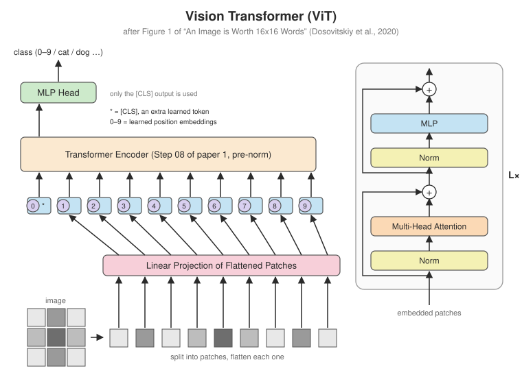
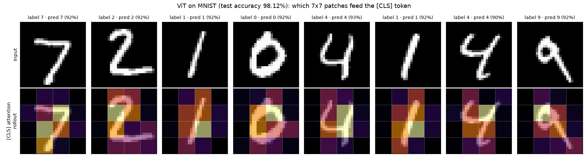

# Paper 2 · An Image is Worth 16x16 Words (Vision Transformer)

<p align="center"></p>

**Paper:** Dosovitskiy, A., Beyer, L., Kolesnikov, A., et al. (2020). *An Image is Worth 16x16 Words: Transformers for Image Recognition at Scale.* ICLR 2021. [arXiv:2010.11929](https://arxiv.org/abs/2010.11929)

## The big idea

Paper 1's Transformer works on sequences of word vectors. ViT asks: what if an image were
a sentence? Cut it into patches, treat each patch as a "word", and feed the sequence to an
**unmodified Transformer encoder**. There are no convolutions in the model itself (apart from
a stride trick for the patch projection).

The encoder here is literally [Step 08](../step08_encoder) from paper 1, imported as-is.
Only the two ends are new:

| | Paper 1 (text) | Paper 2 (images) |
|---|---|---|
| input tokens | word embeddings (Step 01) | **flattened patches × matrix E** (ViT Step 01) |
| positions | sinusoids (Step 02) | **learned** position embeddings |
| extra token | none | **[CLS]**, whose final vector represents the whole image |
| encoder | Step 08, post-norm | Step 08, **pre-norm** |
| output | next-token probabilities | **class** from the [CLS] vector |

## Roadmap

| | Step | Component | Paper section |
|:-:|---|---|---|
| ✅ | [01](step01_patch_embedding) | Patch embedding (and why it's a convolution) | 3.1, Eq. 1 |
| ✅ | [02](step02_vit_model) | [CLS] token, position embeddings, encoder, head | 3.1, Eq. 1–4 |
| ✅ | [03](step03_train_mnist) | Train on MNIST + attention rollout | 4 (small scale) |

## Results

A ViT with 139,018 parameters (16 patches of 7×7 + [CLS], $d_{model}$ = 64, 4 layers), trained
for 6 epochs on a CPU in about 2 minutes:

| epoch | 1 | 2 | 3 | 4 | 5 | 6 |
|---|---|---|---|---|---|---|
| MNIST test accuracy | 93.2% | 95.6% | 96.6% | 97.6% | 98.0% | **98.1%** |

<p align="center"></p>

Logs and plots: [`results/vit`](../results/vit).

## Run it

```bash
pip install torchvision                                 # for the MNIST dataset
python -m pytest vit
python -m vit.step03_train_mnist.train_mnist            # a few minutes on CPU
python -m vit.step03_train_mnist.attention_map
```

Regenerate the diagrams with `python tools/make_vit_diagrams.py`.
