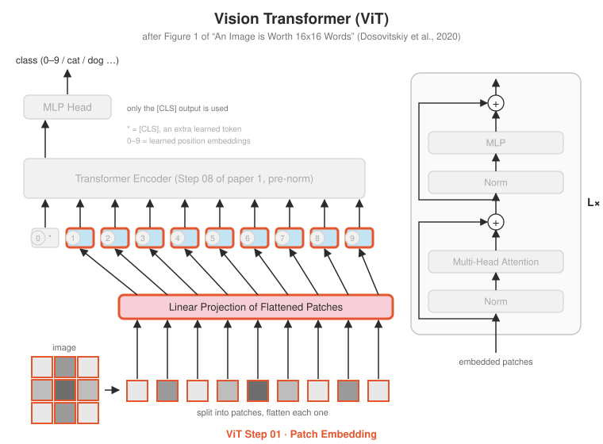

# ViT Step 01 · Patch Embedding

<p align="center"></p>

**Paper:** Section 3.1, Equation 1

## The idea

A Transformer needs a sequence of vectors. ViT makes one from an image:

1. Cut the image into a grid of $P \times P$ patches. A 224×224 image with $P = 16$ gives a
   14×14 grid: **196 patches**.
2. Flatten each patch into a vector of $C \cdot P^2$ numbers (3 × 16 × 16 = 768 for RGB).
3. Multiply each one by the same learned matrix $E$ to get a $d_{model}$-sized embedding.

$$z_0 = [\,x_{class};\; x_p^1 E;\; x_p^2 E;\; \ldots;\; x_p^N E\,] + E_{pos}$$

This step builds the $x_p^i E$ part.

### The convolution trick
"Apply the same linear map to every non-overlapping $P \times P$ patch" is exactly what a
`Conv2d` with `kernel_size = stride = P` computes. It's faster and avoids reshaping, so
real implementations use it. `test_conv_equals_patchify_plus_linear` proves the two give
identical results: the Conv2d's weight, flattened, **is** the matrix $E$.

```
patchify + Linear (the paper's words)       Conv2d(k=P, stride=P) (what code uses)
(B,1,28,28) → (B,16,49) → (B,16,d)          (B,1,28,28) → (B,d,4,4) → (B,16,d)
```

## What's implemented

| File | Contents |
|---|---|
| `patch_embedding.py` | `patchify` (explicit reshape), `PatchEmbedding` (Conv2d), `as_linear()` to get $E$ back |
| `test_patch_embedding.py` | exact patch order on a 4×4 example, **Conv2d == patchify + Linear**, the paper's 224/16 setting, each output depends only on its own patch |

## Run it

```bash
python -m vit.step01_patch_embedding.test_patch_embedding
```

## Try this

- With $P = 16$ on a 224×224 image, attention is over 196 tokens. What happens to the sequence length, and to attention's cost, with $P = 8$?
- The paper's title says 16×16 *words*. In what ways is a patch like a word, and in what ways is it not?
