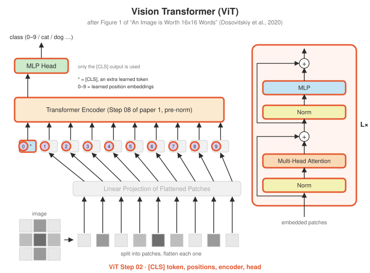

# ViT Step 02 · The Vision Transformer

<p align="center"></p>

**Paper:** Section 3.1, Equations 1–4; Table 1 (model sizes)

## The idea

With patches turned into vectors (Step 01), three small additions make a full classifier.

**1. The [CLS] token.** A learned vector is placed at the front of the sequence. It
corresponds to no patch; through attention it gathers information from all of them, and
its final vector is used as the representation of the whole image. (The idea comes from BERT.)

**2. Learned position embeddings.** Attention can't tell where a patch came from. ViT adds a
learned vector per position (17 here: [CLS] + 16 patches). A test demonstrates the point:
with position embeddings set to zero, **shuffling the patches gives exactly the same output**.

**3. The encoder and head.** The encoder is [Step 08](../../step08_encoder) from paper 1,
reused unchanged in pre-norm mode. A linear head turns the final [CLS] vector into class scores.

```python
x = self.patch_embed(images)                          # (B, 16, d)
x = torch.cat([cls, x], dim=1) + self.pos_embed       # (B, 17, d)    Eq. 1
x = self.encoder(x)                                   # no mask       Eq. 2-3
return self.head(x[:, 0])                             # [CLS] only    Eq. 4
```

There's no mask in the encoder: every patch can look at every other patch, even on the
first layer. A CNN's receptive field grows slowly with depth; ViT's covers the whole image
from the start.

### Seeing what it attends to: attention rollout
`attention_rollout` (Abnar & Zuidema, 2020) multiplies the attention matrices through all
layers, adding the identity for the residual path, to estimate how much each input patch
contributed to [CLS]. Step 03 uses it on a trained model.

## What's implemented

| File | Contents |
|---|---|
| `vit.py` | `VisionTransformer`, `attention_rollout` |
| `test_vit.py` | shapes, 17-token sequence, **ViT-Base/16 has ~86M parameters** (paper: 86M), **patch order only matters because of position embeddings**, rollout, overfits a batch |

## Run it

```bash
python -m vit.step02_vit_model.test_vit
```

## Try this

- Replace the [CLS] token with the mean of all patch outputs (global average pooling). The paper (Appendix D.3) found both work if the learning rate is tuned.
- ViT-B/16 vs ResNet-50: which has more parameters? Why did ViT still need far more data (JFT-300M) to beat CNNs?
