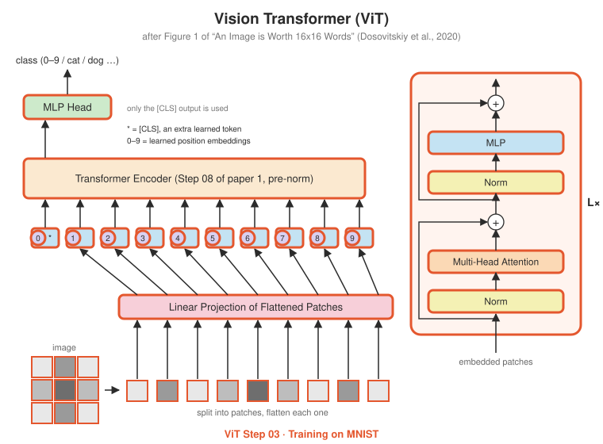
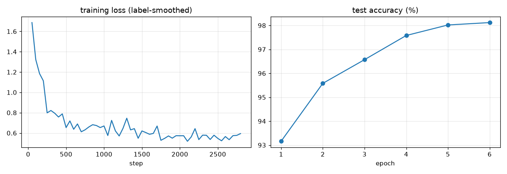
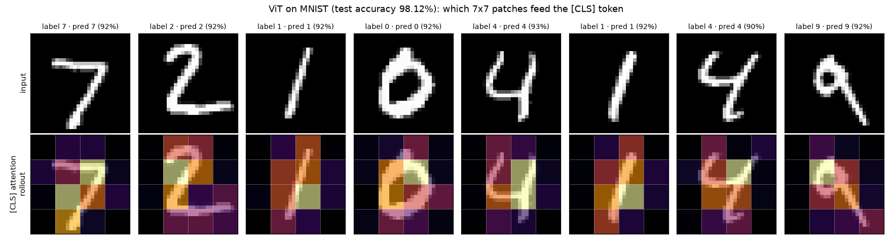

# ViT Step 03 · Training on MNIST

<p align="center"></p>

**Paper:** Section 4 (experiments), at a much smaller scale

## The setup

The paper pre-trains on hundreds of millions of images. Here a ~140,000-parameter ViT learns
handwritten digits on a laptop CPU in a few minutes:

| | |
|---|---|
| image | 28×28 grayscale |
| patches | 7×7, so 16 patches + [CLS] = 17 tokens |
| model | $d_{model}$ = 64, 4 heads, 4 layers |
| training | AdamW, warmup + cosine decay, label smoothing 0.1, 3 epochs by default (`--epochs 6` below) |

## Results

Trained for 6 epochs on GitHub's CPUs (about 2 minutes): **98.12% test accuracy**.

<p align="center"></p>

Attention rollout (bottom row) shows which 7×7 patches flow into the [CLS] token. The
model concentrates on patches containing strokes and largely ignores the empty border.

<p align="center"></p>

## What's implemented

| File | Contents |
|---|---|
| `train_mnist.py` | downloads MNIST (torchvision), trains, reports test accuracy, saves `training_curves.png` |
| `attention_map.py` | attention rollout over 8 test digits, saves `attention_rollout.png` |

## Run it

```bash
pip install torchvision
python -m vit.step03_train_mnist.train_mnist
python -m vit.step03_train_mnist.attention_map
```

## Try this

- Use `patch_size=4` (49 patches + [CLS]). Is it more accurate? How much slower is each epoch, and why?
- Remove `self.pos_embed` from the forward pass and retrain. The model now sees a "bag of patches" with no layout. How much accuracy does it lose on digits?
- Try Fashion-MNIST (`datasets.FashionMNIST`): same shape, much harder.
